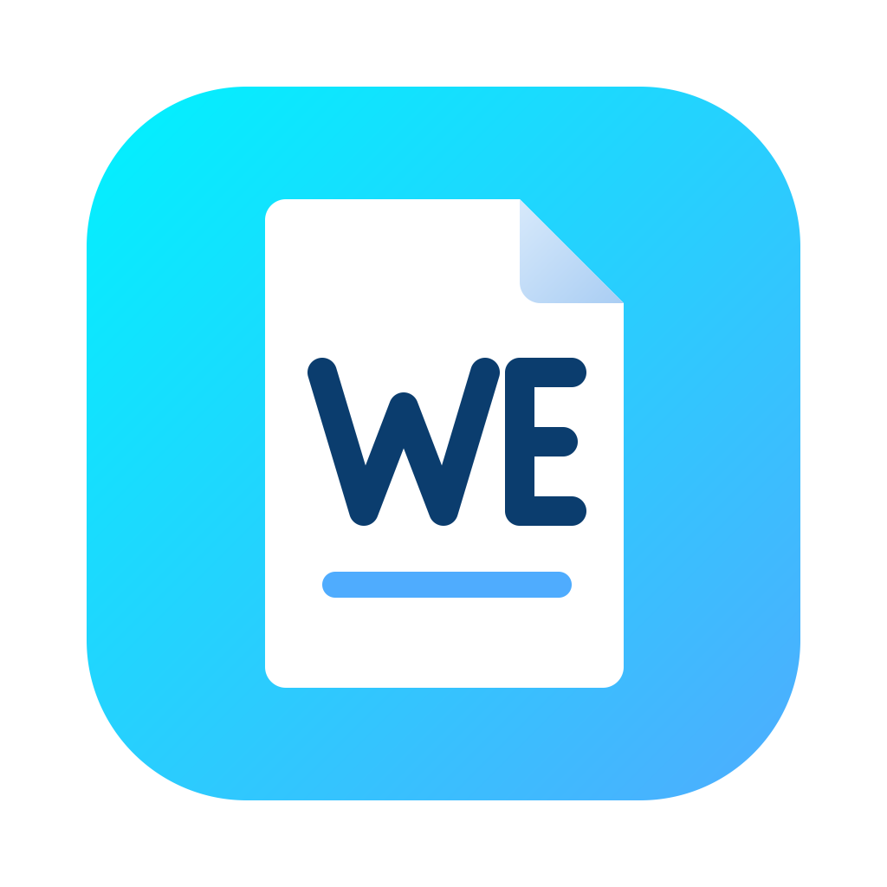
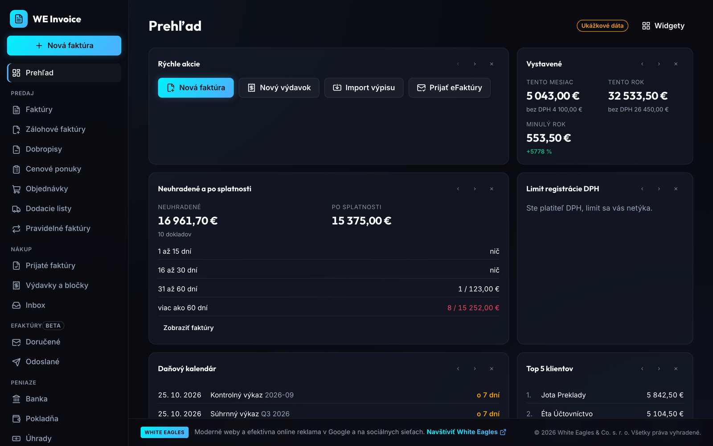
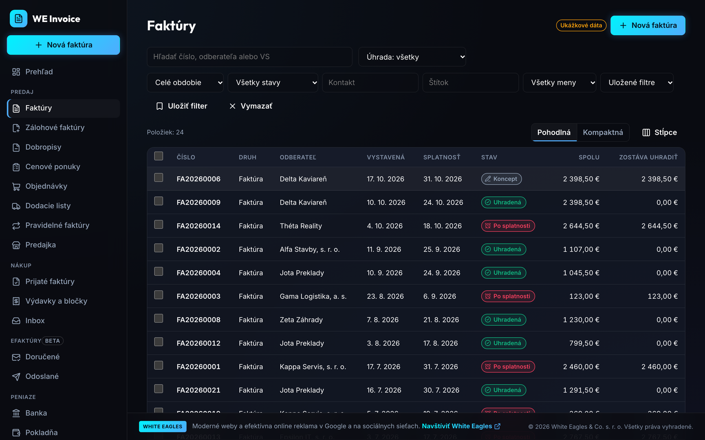
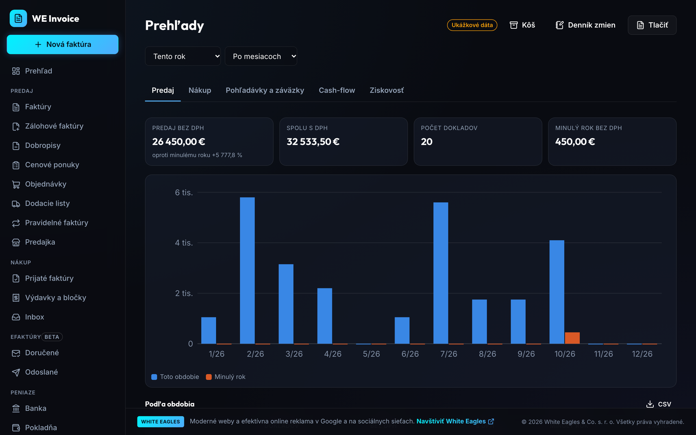
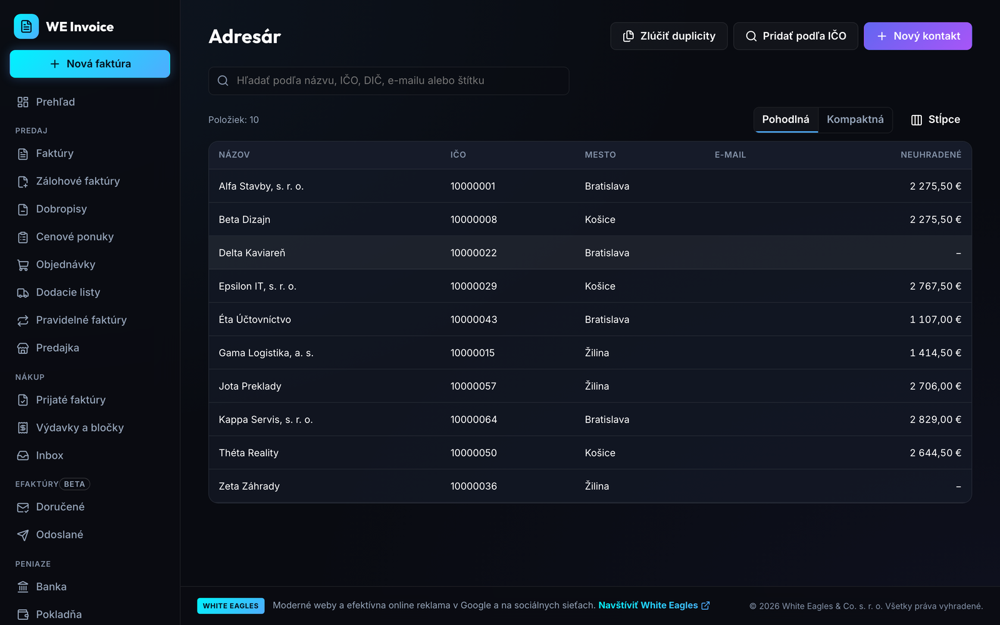
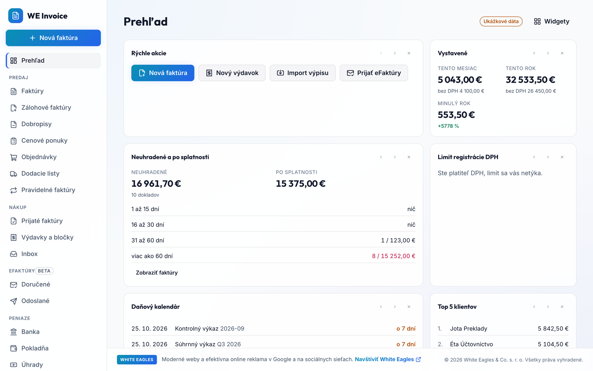
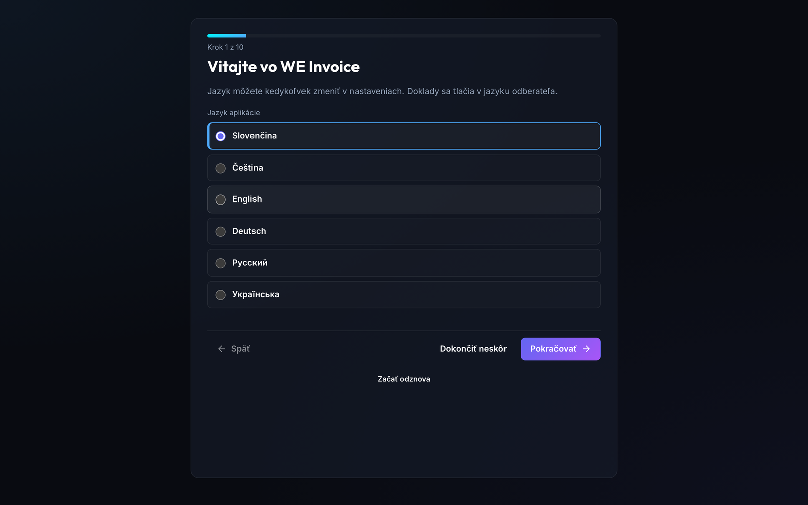
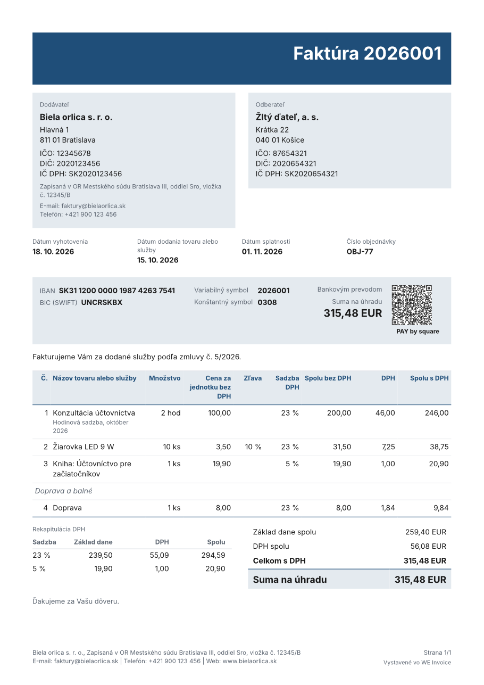
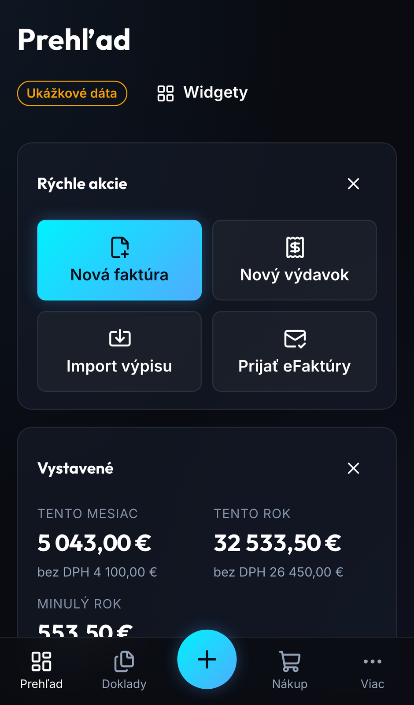
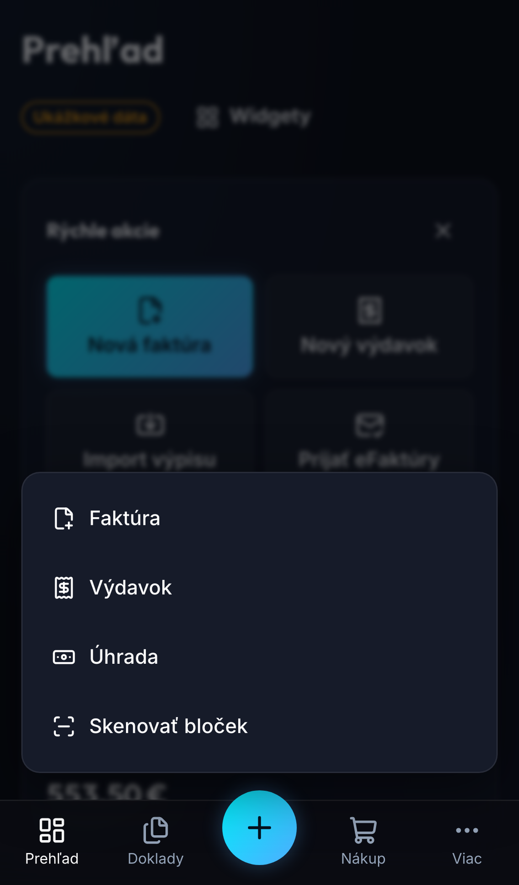

<p align="center">
  
</p>

<h1 align="center">WE Invoice</h1>

<p align="center">
  <b>Free invoicing and eFaktúra (Peppol) for Slovak sole traders and small companies.</b><br>
  Invoices with PAY by square, VAT reports and simple bookkeeping. Your data stays encrypted in your own Google Drive.
</p>

<p align="center">
  <a href="https://github.com/JaffarSk24/WE-Invoice/actions/workflows/ci.yml"></a>
  <a href="LICENSE"></a>
  
  
</p>

<p align="center">
  
</p>

WE Invoice is the third free app of the WE line by [White Eagles](https://whiteeagles.sk/), after [WE Time Tracker](https://github.com/JaffarSk24/WE-Time-Tracker) and [WE Budget](https://github.com/JaffarSk24/WE-Budget). It does what paid Slovak invoicing services charge 5 to 15 € a month for, with no plans, no limits on contacts, documents or companies, and no registration.

**Get it:** [web app](https://jaffarsk24.github.io/WE-Invoice/app/) (also installs on iPhone and Android) · [macOS and Windows](https://github.com/JaffarSk24/WE-Invoice/releases/latest) · [website](https://jaffarsk24.github.io/WE-Invoice/)

> **Version 0.1.0, the first version.** Every feature below is covered by unit and end-to-end tests on desktop and phone screens. The tax reports validate against the official schemas of the Financial Administration and are being checked by an accountant, so check them before you file. eFaktúra is a beta, opened in waves to people from the waiting list.

Slovenská verzia: [README.sk.md](README.sk.md).

## Why WE Invoice

- **Free, really.** Every feature for everyone: recurring invoices, reminders, bank import, several companies, all languages. White Eagles runs no data servers, so there is nothing to charge for.
- **Your data stays yours.** Everything is encrypted on your device (AES-GCM 256) and stored in a "WE Invoice" folder of your own Google Drive. Export everything at any time: JSON, XML, PDF, CSV.
- **Ready for eFaktúra 2027.** From 1 January 2027 Slovak VAT payers issue domestic B2B invoices through Peppol, and every business must be able to receive them. WE Invoice sends and receives them through the certified provider you choose.
- **Made for Slovak law.** Particulars of § 74 of the VAT act are checked before a document is issued; rates, limits, deadlines and legal texts live in a dated configuration, never in code.
- **Open source.** MIT license: read the code, check what it does with your data, build it yourself.

## Features

| Area | What you get | State |
|---|---|---|
| **Start** | "My company" wizard with lookup by IČO in the business register, VAT and bookkeeping modes, bank account with IBAN check, sample data to try everything | Ready |
| **Documents** | Invoices, proforma invoices, tax documents for received payments, credit and debit notes, quotes, orders, delivery notes, cash receipts; conversions between them with links; file attachments | Ready |
| **Totals** | Totals by EN 16931: several VAT rates, line and document discounts at the same time, reverse charge, exemptions, foreign currency, advance deduction, cash rounding to 0.05 € | Ready |
| **Numbering** | Several series per document kind, masks such as `FA{YYYY}{N:4}`, yearly or monthly reset, variable symbol from the number, duplicate numbers resolved after sync | Ready |
| **PDF** | Four templates (Classic, Modern, Minimal, Compact), your logo, stamp and signature, print in Slovak, Czech, English, German or two languages at once, PDF/A-3 with the e-invoice inside | Ready |
| **QR payments** | PAY by square on every invoice, QR Platba for Czech koruna accounts | Ready |
| **eFaktúra (Peppol)** | Sending and receiving through your own certified provider: one universal SAPI-SK adapter plus native adapters, document attachments travel inside the e-invoice, full import of received invoices with all lines, validated against the Peppol and EN 16931 Schematron in CI | Beta |
| **Payments** | Payment state, partial payments, late payment interest by law and the 40 € flat recovery cost | Ready |
| **Bank** | Statement import (CSV of Slovak banks, CAMT.053, MT940, ABO/GPC), smart matching by VS, IBAN, amount and message, SEPA payment orders, cash book and set-off | Ready |
| **Reminders** | Three reminder levels with their own texts, reminders before the due date, sent even when the app is closed (desktop tray) | Ready |
| **Purchases** | Received invoices and expenses, Inbox with QR, PDF text and local OCR recognition, eKasa receipts by QR | Ready |
| **VAT** | VAT records, control statement (KV), EC sales list (SV) and VAT return as XML for the Financial Administration, period closing | Ready, being checked by an accountant |
| **Bookkeeping** | Jednoduché účtovníctvo for sole traders: cash journal, books, fixed assets and depreciation, year-end closing; flat-rate expenses | Ready, being checked by an accountant |
| **Accountant** | Exports for Pohoda, Money S3, Omega, ISDOC, UBL, XLSX and a ZIP for the accountant; migration from iDoklad, SuperFaktúra (files or API), KROS and Shoptet orders, old .xls files; full backup with a password | Ready |
| **Contacts** | Clients by IČO from the business register, VIES and VAT payer reliability lights, print language and terms per client, history and balance | Ready |
| **Recurring** | Recurring invoices issued or drafted on their day and sent by e-mail; SMTP on the desktop, mailto on the web | Ready |
| **Stock** | Warehouses, receipts and issues from documents, average cost or FIFO, price levels for clients, quick sale with the data for the VRP cash register (a reverse-charge sale becomes a full invoice) | Ready |
| **Reports** | Sales, receivables and payables by age, cash flow forecast, profitability; global search, recycle bin and change log | Ready |
| **Sync** | End-to-end encryption with a password and a 24-word recovery key, Google Drive sync between devices, attachment files included and kept for the 10-year archive period, several companies | Ready |
| **Platforms** | Web app that installs on iPhone and Android (PWA, works offline), desktop app for macOS (Intel and Apple silicon) and Windows with a tray icon | Ready |
| **Languages** | Interface in Slovak, Czech, English, German, Russian and Ukrainian, chosen per device; documents print in their own language (Slovak by default, the client's language when set on their card) | Ready |

## Screenshots

<table>
  <tr>
    <td width="50%"></td>
    <td width="50%"></td>
  </tr>
  <tr>
    <td width="50%"></td>
    <td width="50%"></td>
  </tr>
  <tr>
    <td width="50%"></td>
    <td width="50%" align="center"></td>
  </tr>
  <tr>
    <td colspan="2" align="center"> </td>
  </tr>
</table>

## eFaktúra through your own provider

WE Invoice is not a Peppol access point and does not resell one. You sign a contract with any certified Slovak provider (digitálny poštár), many of whom receive for free and charge a few cents per sent invoice, and paste your API key into the app. WE Invoice talks to the provider through the SAPI-SK standard, so it works with every provider that implements it, and with native adapters where a provider offers more (delivery status, validation). Switching providers loses nothing: the archive of your e-invoices (the original XML, kept for 10 years as the law requires) stays in your Drive.

The connection wizard lists the providers with their current tariffs, free tiers and API availability (`packages/core/peppol/providers.json`).

## Privacy and security

- Business data never reaches a White Eagles server. It is encrypted on your device with a random data key; the key is wrapped by your password and by a 24-word recovery key.
- The gateway (`gateway/`) only relays requests the browser cannot make itself: public registers (RPO, ARES, VIES), ECB rates, eKasa receipts and, in the web version, calls to your Peppol provider. Provider keys and tokens pass through it for the duration of a request and are never logged, cached or stored. The desktop app calls providers directly, without the gateway.
- No analytics or trackers in the app. The website loads Google Analytics only after consent.

Full details are in the [privacy policy](https://jaffarsk24.github.io/WE-Invoice/privacy.html).

## Installing

**Web and phone:** open [jaffarsk24.github.io/WE-Invoice/app](https://jaffarsk24.github.io/WE-Invoice/app/) and add it to the home screen (Safari: Share, Add to Home Screen; Chrome: Install app). It works offline after the first start.

**Desktop:** installers come from the [latest release](https://github.com/JaffarSk24/WE-Invoice/releases/latest). The app updates itself from there and checks the sha512 of every download against the release's `latest-mac.yml` or `latest.yml`.

### macOS (10.15 or newer, Intel and Apple silicon)

1. Download `WE-Invoice-<version>-mac-universal.dmg`, open it and drag WE Invoice to Applications.
2. Before opening the app for the first time, run this once in Terminal:

   ```bash
   xattr -cr "/Applications/WE Invoice.app"
   ```

   The app is signed ad hoc and not notarized by Apple. Files downloaded in a browser carry a flag that makes macOS refuse such apps; the command removes it. After that WE Invoice opens like any other app, and its own updates need no such step.

### Windows (10 or newer, 64-bit)

1. Download `WE-Invoice-<version>-win-x64.exe` and run it. It installs for the current user only, without administrator rights, with shortcuts on the desktop and in the Start menu.
2. The installer is not signed with a paid certificate, so SmartScreen shows "Windows protected your PC". Click "More info", then "Run anyway". Updates installed by the app itself do not show this screen. Windows 11 with Smart App Control turned on does not run unsigned apps at all, so WE Invoice cannot be installed there until the installer is signed.

Data of the desktop app lives in `we-invoice-data` inside the user's application data folder (`~/Library/Application Support` on macOS, `%APPDATA%` on Windows), with a daily local backup of the last 14 days in `backups/`.

## Architecture

```
app/              client: vanilla JS + Vite, one code base for the web and the desktop
packages/core/    pure domain logic: money, VAT, documents, numbering, UBL, tax, bookkeeping
desktop/          Electron main process and preload bridges (storage, network, mail, tray, updates)
gateway/          stateless Fastify gateway: provider proxy, registers, rates, waitlist
site/             website in six languages, privacy policy and terms (GitHub Pages)
tests/            repository checks, end-to-end tests and fixtures
```

Rules the code follows: money only as decimal strings through big.js, never floats; legislation values only in `packages/core/legislation/*.json` with their validity dates and sources; interface texts only through the dictionaries; a damaged data file is never overwritten.

## Development

Node 22.12 or newer.

```bash
npm install
npm run dev            # web client at http://localhost:5173
npm run dev:desktop    # Electron
npm test               # unit tests (core, app, desktop, site)
npm run test:perf      # performance tests, run alone
npm run test:e2e       # Playwright: desktop, iPhone 14, Pixel 7
npm run lint
npm run build:web      # dist-web/ for GitHub Pages (/WE-Invoice/app/)
npm --prefix gateway install && npm run test:gateway
```

## Roadmap

Version 0.1.0 already holds the four planned releases: public invoicing, the eFaktúra beta, money and purchases, taxes and bookkeeping.

| Next | What |
|---|---|
| **eFaktúra for everyone** | The beta opens in waves before the duty starts on 1 January 2027 |
| **Accountant's check** | The KV, SV and VAT return confirmed by an accountant, then the "check before you file" note goes away |
| **Signed installers** | Notarized macOS app and a signed Windows installer, so no Terminal command and no SmartScreen warning |
| **eKasa** | Cash register documents through a certified cloud register, once a provider shows its certification |

## License

[MIT](LICENSE), White Eagles & Co. s. r. o.

<p align="center">
  <sub>WE Invoice is free. White Eagles builds websites and runs Google and Meta advertising: <a href="https://whiteeagles.sk/">whiteeagles.sk</a></sub>
</p>
