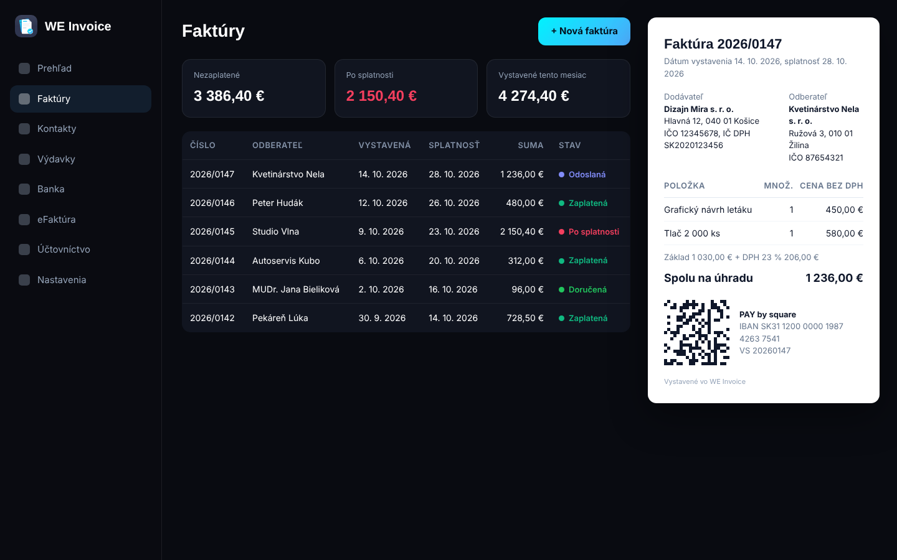

# WE Invoice
*Fakturace a eFaktura zdarma. Opravdu zdarma.*
Faktury, eFaktura přes Peppol pro Slovensko, ISDOC a QR Platba pro Česko, banka, upomínky, výdaje, výkazy DPH a jednoduché účetnictví (daňová evidence) pro živnostníky / OSVČ a malé firmy na Slovensku a v Česku. Bez registrace, bez limitů a bez placených balíčků. Data jsou zašifrovaná ve vašem Google Drive, ne na cizím serveru. Otevřený kód pod licencí MIT.

## Co umí
- Faktury, zálohové faktury, dobropisy, nabídky a prodejky s QR kódem PAY by square
- eFaktura přes Peppol (Slovensko) s poskytovatelem podle vašeho výběru, ISDOC pro Česko
- Import bankovních výpisů a automatické párování plateb
- Upomínky ve třech úrovních s úroky z prodlení
- Skenování účtenek a QR kódů eKasy přímo v zařízení
- Kontrolní výkaz DPH, souhrnné hlášení a přiznání k DPH v XML
- Jednoduché účetnictví (daňová evidence) a podklady k daňovému přiznání
- Neomezený počet firem, dokladů a kontaktů
- Šest jazyků rozhraní, tisk dokladů i dvojjazyčně
[Otevřít webovou aplikaci](https://jaffarsk24.github.io/WE-Invoice/app/) · [Stáhnout pro Mac / Windows](https://github.com/JaffarSk24/WE-Invoice/releases/latest) · [Stránka aplikace](https://jaffarsk24.github.io/WE-Invoice/cs/) · [Zdrojový kód na GitHubu](https://github.com/JaffarSk24/WE-Invoice)
## Časté otázky
**Proč je WE Invoice zdarma?**

Nemá téměř žádné provozní náklady: data jsou ve vašem Google Drive, stránka běží na GitHubu a eFaktury si platíte přímo poskytovateli. Pro White Eagles je aplikace ukázkou práce a cestou k majitelům malých firem.

**Kde jsou moje data?**

Zašifrovaná ve vašem zařízení a ve vašem Google Drive. Server White Eagles je jen brána k poskytovatelům eFaktur a rejstříkům, nic si neukládá.

**Musím od roku 2027 přijímat eFaktury?**

Na Slovensku ano, každý podnikatel, i neplátce DPH; WE Invoice je přijme celé, se všemi řádky, přes poskytovatele, u kterého je přijímání často zdarma. V Česku k 10/2026 taková povinnost přes Peppol neplatí; české firmy mají v aplikaci ISDOC, QR Platbu a ARES.

**Nahradí to účetního?**

Ne. Připraví podklady a exporty, odpovědnost za daňové doklady zůstává na vás nebo na vašem účetním.